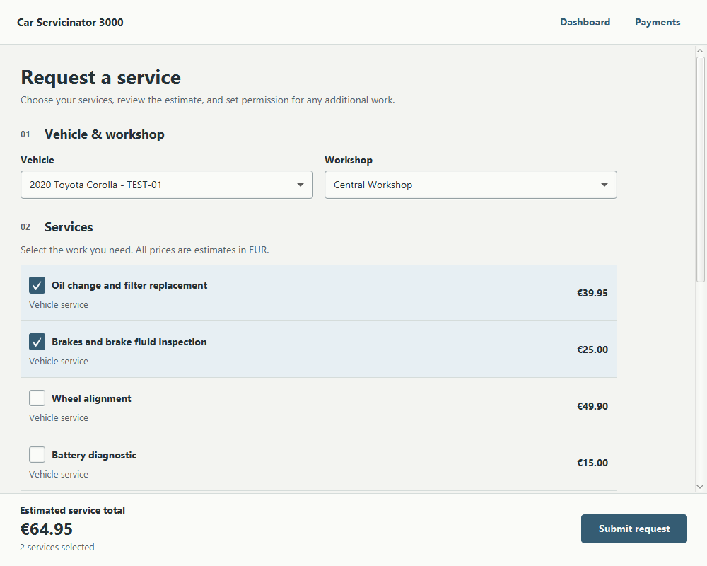

# Car Servicinator 3000

A Java 21 desktop application for managing car service requests, built with JavaFX and Supabase. Clients request work for existing vehicles, mechanics manage requests, and administrators review operational and revenue summaries.

The repository contains the desktop application and local tests. Running it against a backend requires an existing Supabase database that matches the application models; database migrations and access policies are not included.

## Application workflow

| Role | Available functionality |
| --- | --- |
| Client | Choose an existing vehicle and shop, select catalog services, review an estimate, submit a request, filter request history, and view payment records. |
| Mechanic | Filter requests, accept or reject pending work, complete an assigned request with a final price, and create its payment record. |
| Admin | View request counts, status distribution, completed payment totals, and revenue charts. |

Registration offers client and mechanic accounts. An administrator account and any required shop assignments must be provisioned through the backend.

The payment screen marks database payment records as completed. It does not charge a card or connect to a payment provider. There is no vehicle registration or editing screen; vehicles must already exist in the backend.

### Service requests and pricing



Request form preview using synthetic test data.

The request form loads vehicles, shops, and services from Supabase in the background. It presents loading, empty, and error states, with retry when loading fails.

- Services are identified by UUID, so duplicate names remain distinct.
- An immutable catalog snapshot supplies both the displayed estimate and the saved estimate.
- Prices use `BigDecimal`. Missing, negative, or fractional-cent prices are unavailable; zero is valid.
- Submission requires a signed-in client, vehicle, shop, and at least one available service.
- Saving runs in the background and disables repeat submission while a write is pending.
- A failed save preserves the form. If the result is uncertain, check existing requests before retrying.

The current submission writes a `service_requests` record with a description and estimated total. It does not create `service_request_items` rows. The desktop estimate is not an authoritative server-side price calculation.

## Technology

| Component | Implementation |
| --- | --- |
| Runtime | Java 21 |
| Desktop UI | JavaFX 21.0.6, FXML, CSS |
| Backend access | Supabase Auth and PostgreSQL through the REST API |
| HTTP and JSON | OkHttp 4.12.0 and Jackson 2.17.2 |
| Build | Maven wrapper, compiler plugin, JavaFX plugin, Shade plugin |
| Tests | JUnit 5 with Maven Surefire |

Dependency and plugin versions are defined in [pom.xml](pom.xml). The Maven wrapper downloads Maven 3.8.5; a separate Maven installation is not required.

## Getting started

### 1. Prepare the environment

Install JDK 21, set `JAVA_HOME` to its installation directory, and ensure Java is on your `PATH`. A graphical desktop is required to run the app and JavaFX controller tests. The first build needs network access to download Maven and dependencies.

Clone the repository and enter its directory:

```sh
git clone https://github.com/Vkhvedelidze/Car-Servicinator-3000.git
cd Car-Servicinator-3000
```

Windows PowerShell, adjusting the installation path:

```powershell
$env:JAVA_HOME = 'C:\Program Files\Java\jdk-21'
$env:Path = "$env:JAVA_HOME\bin;$env:Path"
.\mvnw.cmd -version
```

macOS or Linux, using your installed JDK's directory:

```sh
export JAVA_HOME="/path/to/jdk-21"
export PATH="$JAVA_HOME/bin:$PATH"
chmod +x mvnw
./mvnw -version
```

Confirm that the wrapper reports Java 21 before continuing. These environment assignments apply to the current shell.

### 2. Configure the backend connection

Create `src/main/resources/supabase.properties`:

```properties
supabase.url=https://YOUR_PROJECT.supabase.co
supabase.key=YOUR_PUBLIC_ANON_KEY
supabase.anon.key=YOUR_PUBLIC_ANON_KEY
```

Use the same public Supabase `anon` key for both key properties. The REST client currently reads `supabase.key`, while the Auth client reads `supabase.anon.key`.

The file is ignored by Git. Configuration is loaded from this classpath resource; environment-variable overrides are not implemented. Maven copies the file into build output and packaged artifacts, so never place a privileged `service_role` key or other backend secret in it.

A connection file alone does not provision a working backend. Read the database contract and authentication limitation below before connecting to a project.

### 3. Run the application

Windows PowerShell:

```powershell
.\mvnw.cmd clean javafx:run
```

macOS or Linux:

```sh
./mvnw clean javafx:run
```

For IDE use, import the Maven project, select JDK 21 as both the project SDK and Maven runner JDK, and run the `javafx:run` Maven goal.

## Backend contract and limitations

No SQL schema, migrations, seed data, Auth trigger definitions, or Row Level Security policies are tracked. Obtain the matching backend setup from the project maintainer. The Java models describe the fields the app reads and writes, but do not fully define database constraints, defaults, relationships, or permissions.

The REST services reference these tables:

| Table | Relevant model fields |
| --- | --- |
| `users` | `id`, `auth_user_id`, `email`, `full_name`, `role`, `shop_id` |
| `vehicles` | `id`, `client_id`, `make`, `model`, `year`, `license_plate` |
| `mechanic_shops` | `id`, `name`, `address`, `city`, `phone` |
| `services` | `id`, `name`, `description`, `base_price` |
| `service_requests` | Client, vehicle, shop and mechanic IDs; status; estimated and final totals; notes; service description |
| `service_request_items` | Request and service IDs; quantity; estimated and final prices; source; approval flag |
| `payments` | `id`, `service_request_id`, `amount`, `status` |
| `service_status_updates` | `id`, `service_request_id`, `status`, `note`, `created_by` |

See [the model package](src/main/java/com/example/programminggroupproject/model) for exact JSON names and Java types. IDs are UUIDs and monetary fields use `BigDecimal`. Status strings are case-sensitive in application logic, including `Pending`, `In Progress`, `Completed`, and `Rejected`.

### Authentication and access control

Each Supabase Auth account needs a corresponding `public.users` profile whose `auth_user_id` matches `auth.users.id`. Signup expects a backend trigger to create that profile, although the code also attempts a fallback insert. Registration currently expects an immediate Auth session and does not handle email-confirmation-only signup responses correctly.

There is a known authentication limitation: signup and login query `public.users` before attaching the newly issued access token to the REST client. With the public key configuration above, restrictive RLS policies can therefore prevent profile lookup and login even when the password is correct. This requires a change to authentication initialization; embedding a privileged key is not a solution.

The dashboard's role-specific navigation is a UI behavior, not an authorization boundary. Backend policies must independently enforce ownership, role assignment, and allowed updates. No deployed policy configuration is verified by this repository's tests.

Mechanic completion updates status, final price, and payment data through separate requests. These writes are not an atomic transaction. Other screens also retain synchronous backend calls and may pause during slow network responses.

## Architecture

The application follows an FXML/controller structure with a service layer:

```text
FXML views and CSS
    -> JavaFX controllers
    -> Domain logic and entity services
    -> Supabase HTTP clients
    -> Supabase Auth / REST API
```

Within `src/main/java/com/example/programminggroupproject/`:

| Path | Responsibility |
| --- | --- |
| `CarServiceApp.java` | Creates the JavaFX application and login scene. |
| `Launcher.java` | Entry point for the packaged JAR. |
| `controller/` | Screen behavior, navigation, and presentation state. |
| `service/ServiceCatalog.java` | Immutable service identities, price validation, and quotes. |
| `service/ServiceRequestSubmission.java` | Validates a request and invokes its persistence boundary. |
| `service/BaseSupabaseService.java` | Shared REST CRUD and query operations. |
| `service/` | Entity-specific operations and authentication workflow. |
| `client/` | HTTP requests, JSON serialization, and authentication headers. |
| `model/` | Database and authentication response models. |
| `session/` | Current in-memory user and authentication session. |
| `config/` | Classpath configuration loading. |

FXML and stylesheets live in `src/main/resources/com/example/programminggroupproject/`. Tests mirror the Java package structure under `src/test/java/`.

## Testing

Run the local suite:

```powershell
# Windows PowerShell
.\mvnw.cmd test
```

```sh
# macOS or Linux
./mvnw test
```

Tests cover catalog validation, exact decimal estimates, request validation and serialization, and request-form behavior using fake persistence. They do not require Supabase credentials or contact a live backend. JavaFX tests require a graphical environment.

See [docs/TESTING.md](docs/TESTING.md) for display requirements, Linux CI setup, and a command to run domain tests without JavaFX. Local test success does not verify a deployed database, authentication policies, or live payment processing.

## Packaging

Use `./mvnw clean package` on macOS/Linux or `.\mvnw.cmd clean package` on Windows. This runs tests and builds the shaded JAR:

```sh
java -jar target/Programming-Group-project-1.0-SNAPSHOT.jar
```

The JAR requires Java 21 and includes resources from the build, including any local Supabase configuration. JavaFX has platform-specific native dependencies: build and validate the artifact on each intended operating system and architecture. The shaded JAR is not a universal desktop installer; packaging alone does not verify that it launches on another platform.

The current dependency set produces Shade warnings about overlapping resources. The local build succeeds, but dependency consolidation and cross-platform launch validation remain follow-up work.

## Troubleshooting

| Symptom | Check |
| --- | --- |
| `JAVA_HOME` error or invalid target release | Set `JAVA_HOME` to JDK 21 and verify with the wrapper's `-version` command. |
| `Unable to find supabase.properties` | Create the file directly in `src/main/resources/`, then rebuild. |
| Login fails after successful Auth | Check the matching `public.users.auth_user_id` profile and the token-initialization limitation described above. |
| Registration creates an account but reports failure | Check the profile trigger and whether Auth requires email confirmation. |
| Request form cannot load | Check connectivity, backend availability, matching schema, and access policies, then retry. |
| A service cannot be selected | Its price must be present, nonnegative, and exactly representable to two decimal places. |
| No vehicles or shops appear | Provision matching records in the backend; vehicle creation is not exposed in the app. |
| JavaFX tests fail to initialize | Run with a graphical display or follow the Linux virtual-display instructions in the testing guide. |

## Contributors

Michail Sifakis, Denis Sokolov, Vako Khvedelidze, Gonzalo Nicolas, and Oliver Holmes.

